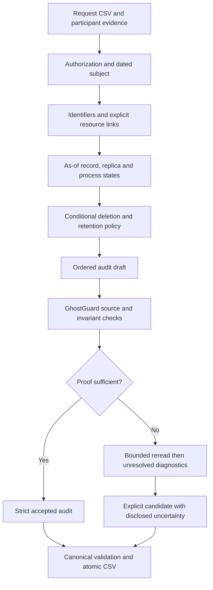

# GhostTrace Guard

An evidence-grounded deletion-audit CLI for HackerRank Orchestrate October 2026, **Ghost Data Still Exists**. Runtime version: **0.6.0**.

**Submission status: C — operational best-effort candidate, not fully contract-compliant.** All **518 rows** are generated, but **case_479, case_503 and case_55** fail the official plan contract. **103 decisions remain uncertain**. These limits are part of the result, not a passing validation claim.

**Judges: open the [solution branch](https://github.com/YellankiKaushik/Hacker-Rank---Orchestrate/tree/feat/orchestrate-october26).** The repository-root URL currently opens the original starter on default branch `main`. Source, tests and reports are on `feat/orchestrate-october26`; `main` has deliberately not been merged or rewritten.

## The problem

A deletion workflow can report success while personal data remains in replicas, support attachments, search indexes, exports, analytics or retained records. Synchronization and backup restoration can recreate it. An audit must establish the actual state at each request's `audit_at`, including historical identifiers and required retention, rather than repeat workflow status.

GhostTrace Guard builds dated, scoped evidence relationships, challenges proposed results against original sources, then compiles ordered findings, safe remediation and verification. It proposes actions; it does not delete real services or alter the supplied evidence.

## Architecture and execution



| Component | Actual implementation | Boundary |
|---|---|---|
| **GhostTrace** | Authorization, historical identity, provenance-aware resources, heterogeneous evidence, as-of states, replica drift, policy and plan compilation | Missing selectors, ownership or permission remain unknown; discovery is not exhaustive |
| **GhostGuard** | Reopens sources; checks hashes, citations, scope, chronology, known obligations and final checks; separate raw-value/authorization vetoes; one bounded reinvestigation | Extraction, identity relationships and parts of policy remain shared; not a fully independent oracle |
| **AuditShield** | Deterministic-first indexes, content-hashed OCR cache, bounded optional AI, actual telemetry and reproducible serialization | No runtime LLM investigator/reviewer or demonstrated full-dataset AI accuracy gain |

Read the [actual architecture and capability evidence](code/docs/ACTUAL_ARCHITECTURE.md) and [implementation status](code/docs/IMPLEMENTATION_STATUS.md). Original local design proposals are not treated as implemented features.

## Evidence and safety

- **Formats:** CSV metadata; JSON/text records; log dialects; isolated SQLite-compatible SQL captures; PDF text with pinned pypdf; PNG screenshots through Windows English OCR or tesseract English.
- **Identity/provenance:** dated current/historical email, phone and hash aliases plus stable IDs; exact identifiers and explicit catalog/resource links. Facts preserve source ID, capture/observation times, scope and locator. No case-suffix, row-position, name-similarity or proximity joins.
- **Cutoffs/copies:** source availability, effective observation and binding must be admissible at `audit_at`. Operation success is a claim. Primary absence cannot clear an untreated replica; partial inventory cannot prove global absence.
- **Policy:** delete/redact/anonymize/retain according to actual conditions. Preserve active legal holds/security retention and permitted tombstone references while removing prohibited direct identifiers. Attachment uploader/association is not exclusive ownership.
- **Recreation:** disable established active flows and block unsafe restores before dependent record changes. Archive existence is not restore permission. No owner, permission or unsupported finding is invented.
- **Contradictions:** R04 authorization and R05 compliant-label defects have regression coverage. Exposed identifying fields can contradict REDACTED/ANONYMIZED, including nested fields. Independent reviewer invariants catch deliberately correlated wrong parser states.

## Clone this solution and install

```powershell
git clone --branch feat/orchestrate-october26 --single-branch https://github.com/YellankiKaushik/Hacker-Rank---Orchestrate.git GhostTrace-Guard
cd GhostTrace-Guard
```

Use **CPython 3.12+**; commands assume `python` resolves to it. Windows needs **English OCR language support** and permission for the OCR helper to read screenshots. Restrictive sandboxes may deny Windows.Media.Ocr even when language support is installed.

```powershell
python -m venv .venv
.venv\Scripts\python.exe -m pip install -r code/requirements.txt
```

The Python requirement is pinned `pypdf==6.10.0`; OCR is a separate platform dependency. On macOS/Linux use `.venv/bin/python` and install tesseract with English data. **Non-Windows OCR fidelity is not verified.** No warm OCR cache or model credential is required/supplied for default inference.

For a ZIP extraction, place unchanged participant `dataset/` beside `code/` and `README.md`. The Git branch retains the original official participant inputs; `code.zip` deliberately excludes them.

## Run and validate

Generate the explicit best-effort candidate:

```powershell
.venv\Scripts\python.exe -X utf8 code/main.py --mode candidate
.venv\Scripts\python.exe -X utf8 code/independent_contract.py
```

Candidate mode atomically writes root `output.csv` and a separate uncertainty report. **The independent checker currently exits nonzero and reports all three invalid plans.** This is an official contract failure, not an installation error.

Default `python code/main.py` is **strict** and refuses output replacement while **103 cases are unresolved**. A strict failure preserves existing output; candidate export is not proof those cases are correct.

```powershell
.venv\Scripts\python.exe -X utf8 -m unittest discover -s code/tests -v
.venv\Scripts\python.exe -X utf8 code/validate_candidate.py
```

`independent_contract.py` has its own CSV/JSON/enum/order rules and no Engine imports. `validate_candidate.py` checks emitted source/binding/policy claims using shared domain code and raw invariants; its PASS does not prove missing obligations. `validate_output.py` requires strict acceptance and rejects the present candidate.

External/isolated paths: `--dataset`, `--requests`, `--output`, `--cache-dir`, `--metrics-path`, `--uncertainty-report`. Defaults resolve relative to source root, not the shell's working directory.

## Output contract

```csv
case_id,deletion_status,steps_json
```

Exactly 518 expected rows, lexicographically sorted by `case_id`. Status: COMPLETE, INCOMPLETE or NOT_APPLICABLE. Every step has exactly `step_no`, `phase`, `system_id`, `resource_id`, `operation`, `state`, `evidence_id`; consecutive numbering starts at one. Sort by official phase → operation → system → resource order. JSON object-key order is ignored; array order matters.

Findings and COMPLETE current-state checks cite admissible file/activity/audit IDs. Future INCOMPLETE remediation/checks use empty citations. NOT_APPLICABLE requires genuine non-deletion authorization and `[]`. INCOMPLETE needs all three phases; the three known exceptions fail this requirement. Full enum/state definitions: [official problem statement](https://github.com/YellankiKaushik/Hacker-Rank---Orchestrate/blob/feat/orchestrate-october26/problem_statement.md).

## Measured evaluation

The independent scorer reads reference answers **after inference**, keeping all 32 cases in its denominator. Production never reads sample answers. Public references contain no NOT_APPLICABLE cases; authored negative-intent tests cover that behavior.

| Metric | Current measured result |
|---|---:|
| Candidate status accuracy | **29/32 — 90.625%** |
| Exact ordered cases / sequence | **8/32 — 25%** |
| Exact seven-field step precision | **107/158 — 67.72%** |
| Exact seven-field step recall | **107/193 — 55.44%** |
| Padded positional field agreement | **917/1365 — 67.18%** |
| Reference citation agreement | **57/58** |
| Missing / extra resource occurrences | **36 / 3** |
| Primary / strict / candidate statuses | **27/32 / 22/32 / 29/32** |
| Shared strict full-input acceptances | **415/518** |
| Candidate rows | **518/518** |
| Tests | **155 passing; 0 failing/skipped** — 154 prior regressions plus one clean-checkout packaging test |

Exact-step matching includes numbering/citation; field agreement pads insertions/omissions. Citation agreement is reference agreement, not source truth. GhostGuard conservatively withholds more sample decisions; no accuracy gain from review is claimed. Public results do not establish hidden-case accuracy or leaderboard performance.

Read the required [evaluation report](code/evaluation/evaluation_report.md), [usage report](code/evaluation/usage_report.md) and [case-level proof-gap review](code/docs/PHASE2_EVIDENCE_REVIEW.md).

## Known limitations and readiness

**OFFICIAL_PLAN_CONTRACT = FAIL.** **case_479 and case_503** contain verification-only INCOMPLETE plans because attachment exclusivity is unavailable. **case_55** has an empty INCOMPLETE plan because target restore permission is unknown. No dummy phases, unsafe deletion or evasive status relabeling was added.

**103 candidate decisions remain uncertain: 90 COMPLETE, 13 INCOMPLETE.** Retained records alone cannot prove deletion; anonymous readbacks cannot be assigned without selectors. The 415 strict accepts are bounded implementation acceptances, not an independent exhaustive semantic certificate. General OCR geometry, ambiguous language and absent relations remain limited. The earlier ninth exact match depended on unsafe attachment ownership and was not restored.

Output distribution: 355 INCOMPLETE / 153 COMPLETE / 10 NOT_APPLICABLE. Output SHA-256:

```text
b4301131db2c2f874feadff55dcc38fea0b595d9b1430d7a8f248ed63b57e283
```

The ZIP hash changes when README/packaged docs change. Its final digest is recorded separately in the tracked hash-bearing release record and private submission manifest; putting it in its own packaged README would be recursive. Generated answers, ZIPs, original logs, raw traces, caches and private staging are intentionally ignored and **not available from GitHub**.

## Optional AI and actual usage

Final 518-case inference used **zero LLM calls, zero tokens, estimated $0 API fee**. Local OCR performs extraction without an exposed LLM model/token meter; compute and coding-session costs are unmeasured.

Optional `--ai` supports bounded ambiguous intent using configured OpenAI or loopback Ollama transport, strict intent/quote schema and contextual revalidation. It cannot emit resource IDs, evidence, policies or steps; the contextual bridge is deliberately narrow. Historical `gemma4:e4b` experiments are separate and demonstrate no full-dataset gain. See [configuration examples/bounds](code/CONFIGURATION.md). Credentials come only from environment variables and must never be committed.

## Project layout

```text
README.md
AGENTS.md / problem_statement.md / agent_trace_instructions.md
code/
  main.py                       # strict/candidate CLI
  ghosttrace/                   # evidence, identity, state, policy, review, compiler, optional AI
  independent_contract.py       # independent all-case shape/plan gate
  validate_candidate.py         # bounded emitted-source checks
  package_submission.py         # reproducible source packaging
  requirements.txt / CONFIGURATION.md
  tests/                        # unit/adversarial/synthetic integration tests
  evaluation/                   # independent scorer and readable evaluation/usage reports
  docs/ACTUAL_ARCHITECTURE.md    # implemented components and proof boundaries
dataset/                        # unchanged official participant inputs; excluded from ZIP
output.csv / code.zip / log.txt  # generated/private, ignored
GhostTrace-Guard-submission/     # private, ignored; not a source ZIP itself
```

## Reproduce code.zip

From a clean solution checkout, without a private checkpoint or dataset:

```powershell
.venv\Scripts\python.exe -X utf8 code/package_submission.py --source-only --output code.zip
```

This selects root README plus allowed `code/` source/docs/tests, sorted members, fixed metadata and normalized LF. It checks safe paths/integrity but **does not run inference or certify semantic correctness**. The hash-bearing `FINAL_RELEASE_RECORD.md` is intentionally excluded. Required reports, prompts/configuration, OCR helper, requirements and independent checker are included; datasets, logs/traces, environments/caches and nested archives are excluded.

Full development report/release commands require saved diagnostics/checkpoints, write reports and may rebuild artifacts. They are maintenance tools, not prerequisites for clean inference. Preserve a frozen baseline first. Test/extracted-run validation remains separate from source-only packaging.

## Submission and attribution

Primary local files are code.zip, output.csv and a privacy-reviewed transcript copy. Structured traces are separate: finish contributing sessions and quit applications before copying/reviewing/redacting original rollouts. No active trace is packaged as complete. Human privacy approval, final trace ZIP, authenticated portal checks and interview remain pending. No upload or completed interview is claimed.

Use the [feature-branch URL](https://github.com/YellankiKaushik/Hacker-Rank---Orchestrate/tree/feat/orchestrate-october26) when branch URLs are accepted. If a portal requires the root URL, the owner must explicitly authorize changing the default branch or a reviewed merge; neither happens automatically.

Challenge attribution: official October [specification](https://github.com/YellankiKaushik/Hacker-Rank---Orchestrate/blob/feat/orchestrate-october26/problem_statement.md), [agent instructions](https://github.com/YellankiKaushik/Hacker-Rank---Orchestrate/blob/feat/orchestrate-october26/AGENTS.md) and [trace instructions](https://github.com/YellankiKaushik/Hacker-Rank---Orchestrate/blob/feat/orchestrate-october26/agent_trace_instructions.md). Official challenge/submission URL: [https://wwww.hackerrank.com/contests/hackerrank-orchestrate-october26/challenges/ghost-data-still-exists](https://wwww.hackerrank.com/contests/hackerrank-orchestrate-october26/challenges/ghost-data-still-exists). No local deadline is configured; verify actual authenticated requirements.
